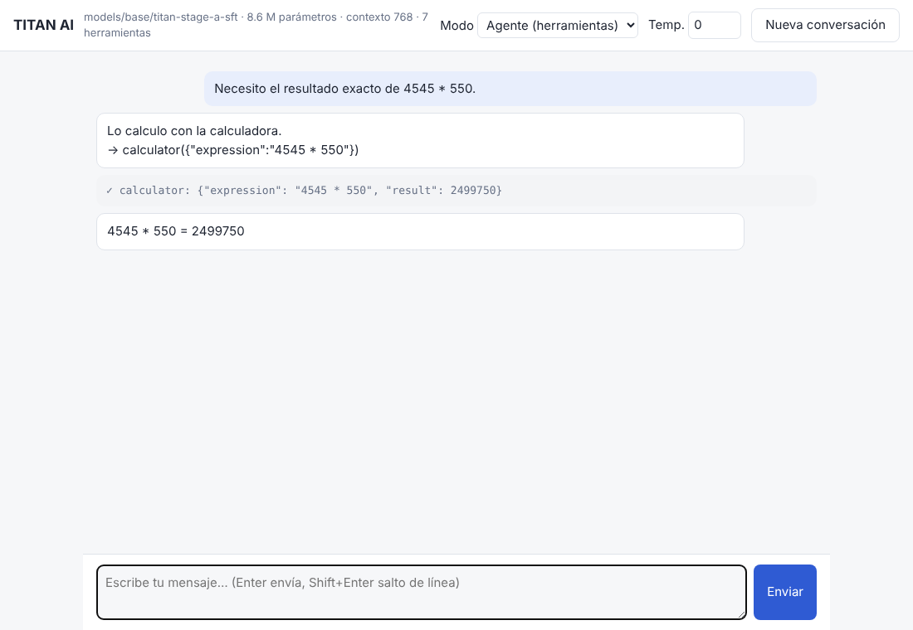

# Evaluación objetiva

`titan eval --checkpoint <ejecución|modelo> --suite all --out informe.json`

Principios:
* Ninguna capacidad se declara sin una medición reproducible: cada suite tiene
  datos fijos versionados en `titan/eval/data/`, verificación por programa y su
  línea base (azar o referencia).
* Separación estricta: los textos de evaluación se indexan antes de limpiar
  los datos y los documentos coincidentes se descartan (`titan data audit` lo
  comprueba a posteriori); las semillas de las tareas sintéticas de evaluación
  están reservadas y nunca se usan para entrenar.
* No se usa ningún modelo externo como juez.
* El número de parámetros, el tamaño de los archivos o la apariencia de las
  respuestas no cuentan como prueba de capacidad.

## Suites

| Suite | Mide | Datos | Métrica | Línea base |
|---|---|---|---|---|
| `bpb` | comprensión/modelado de texto por dominio | shards de validación | pérdida, perplejidad, **bits por byte** (comparables entre tokenizadores) | — |
| `mc` | conocimiento general | 60 preguntas propias en español (geografía, ciencia, matemáticas, lengua, historia, tecnología) | exactitud (bruta y normalizada por longitud), **ECE**, consistencia al reordenar opciones, robustez sin acentos/minúsculas | 25 % |
| `arith` | matemáticas | 300 problemas generados con semilla reservada | coincidencia exacta | — |
| `code` | programación | 20 funciones con tests ejecutados en el sandbox | pass@1 (voraz) | soluciones de referencia: 100 % |
| `instructions` | seguimiento de instrucciones | 20 consignas con restricciones verificables (longitud, formato, JSON, idioma…) | exactitud por consigna y por restricción | — |
| `uncertainty` | reconocimiento de incertidumbre, premisas falsas, ambigüedad | 16 consignas | marcadores léxicos (indicativo) | — |
| `tool_use` | uso de herramientas | 64 tareas con herramientas reales y semillas reservadas | selección correcta, llamadas válidas, respuesta correcta | — |
| `retrieval` | recuperación en contexto largo | dato insertado al 25/50/90 % del contexto | exactitud | — |

Si el prompt de una suite de chat no cabe en el contexto del modelo, se informa
`context_overflow` en lugar de contarlo como fallo.

Benchmarks estándar (MMLU, Global-MMLU en español, ARC, HellaSwag, GSM8K,
HumanEval, MBPP, Belebele `spa_Latn`, XNLI-es) se añadirán como suites cuando
haya acceso a Hugging Face y un modelo que supere el azar; antes de usarlos
deben entrar en `eval_files` para la descontaminación. Solo se compararán con
modelos de referencia en condiciones equivalentes (mismo número de ejemplos,
mismo formato de prompt, misma métrica).

## Resultados medidos

### Etapa A, modelo base (8,6 M parámetros, 20,5 M tokens)

| Suite | Resultado |
|---|---|
| bpb (validación) | es 1,278 · en 1,639 · code 1,810 · math 0,389 · multi 1,613 |
| mc | 20,0 % (normalizada 31,7 %); azar 25 %, IC 95 % ≈ ±11 pp: **no supera al azar** |
| arith | 6,7 % |
| code | 0 % |
| retrieval | 0 % |
| instructions / uncertainty / tool_use | no aplicables (contexto de 256 tokens) |

### Etapa A + SFT de demostración (`reports/eval_stage_a_sft.json`)

SFT de 800 pasos (4,9 M tokens, 43 min de CPU) con 4 750 conversaciones
sintéticas verificadas; contexto ampliado de 256 a 768 tokens.

| Suite | Base | Tras SFT | Comentario |
|---|---|---|---|
| tool_use: herramienta correcta | 12,5 %* | **100 %** | *solo acertaba «no usar herramienta» |
| tool_use: llamadas válidas | 12,5 % | **100 %** | JSON y argumentos válidos según el esquema |
| tool_use: respuesta correcta | 12,5 % | **82,8 %** | resultado de la herramienta trasladado a la respuesta |
| instructions (por consigna) | n/a | 15 % | sin datos de instrucciones generales en el SFT |
| uncertainty | n/a | 0 % | no reconoce lo que no sabe |
| mc | 20,0 % | 15,0 % | ambos en el azar |
| arith (formato de completado) | 6,7 % | 1,3 % | olvido del formato de preentrenamiento |
| code | 0 % | 0 % | |

**Cómo leer estos números.** Las 64 tareas de `tool_use` usan semillas nunca
vistas, pero las **mismas plantillas** que el entrenamiento: demuestran que el
pipeline enseña el protocolo de herramientas (elegir, llamar con JSON válido,
usar el resultado), no que el modelo sea inteligente. Fuera de esas plantillas
falla: en la interfaz, con un espacio de trabajo vacío, inventó el archivo
`notas_9.txt` (un nombre memorizado) y, tras el error, contestó con un número
inventado en lugar de reconocerlo. La bajada en `mc` y `arith` es el olvido
esperable al ajustar un modelo diminuto con datos muy estrechos; a escala se
mitiga mezclando datos de preentrenamiento y conversación general en el SFT.

**Fallo del sistema encontrado y corregido gracias a esta evaluación:** el
agente ofrecía al modelo 14 herramientas en lugar de las 7 del entrenamiento;
el prompt superaba el contexto y el generador recortaba su inicio en silencio,
dejando sitio a un solo token de respuesta (el acierto aparente era del 12,5 %).
Ahora el chat nunca recorta: devuelve `ContextOverflow` y el agente se detiene
con un mensaje claro (`tests/test_agent.py::test_chat_never_truncates_prompt_silently`).

### DPO sobre el modelo SFT (`reports/dpo_stage_a.json`, `reports/dpo_stage_a_sumlogp.json`)

150 pasos (13 min de CPU), β = 0,1, 2 000 pares verificados; evaluación en 200
pares con semillas reservadas.

| Métrica | Antes | Después |
|---|---|---|
| Precisión de preferencia (recompensa implícita vs. referencia) | — (margen 0 por definición) | **94,5 %** (margen 2,52) |
| Cambio relativo de los pesos | — | 0,43 % |

Diferencia de log-probabilidad (respuesta preferida − rechazada, en nats) del
modelo por sí solo:

| Caso | SFT | DPO | ¿Prefiere la honesta/correcta? |
|---|---|---|---|
| calculadora | +10,3 | +15,3 | sí (98 %) |
| base de conocimiento | +16,0 | +24,5 | sí |
| permiso denegado | +38,2 | +91,9 | sí |
| pregunta sin respuesta posible | +118,6 | +174,0 | sí |
| **archivo inexistente** | **−214,0** | **−137,5** | **no (0 %)** |

Lectura: el DPO mueve todas las preferencias en la dirección correcta, pero no
basta para corregir un comportamiento que el SFT nunca enseñó: el modelo
prefiere con mucha fuerza inventar el contenido de un archivo que no existe.
La corrección de fondo ya está en el generador de SFT (escenario
`missing_file`: reconocer que el archivo no existe y pedir confirmación); el
DPO refuerza después. Lección general: el DPO afina comportamientos que el
modelo ya sabe producir; no crea uno ausente.
